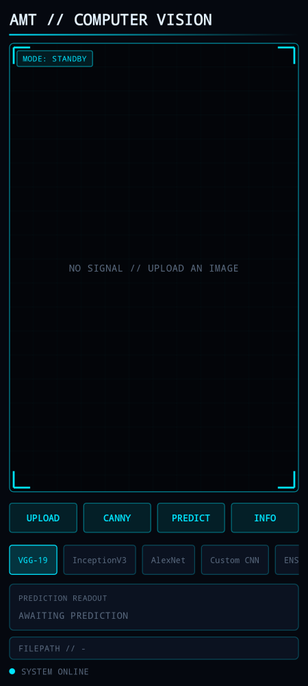
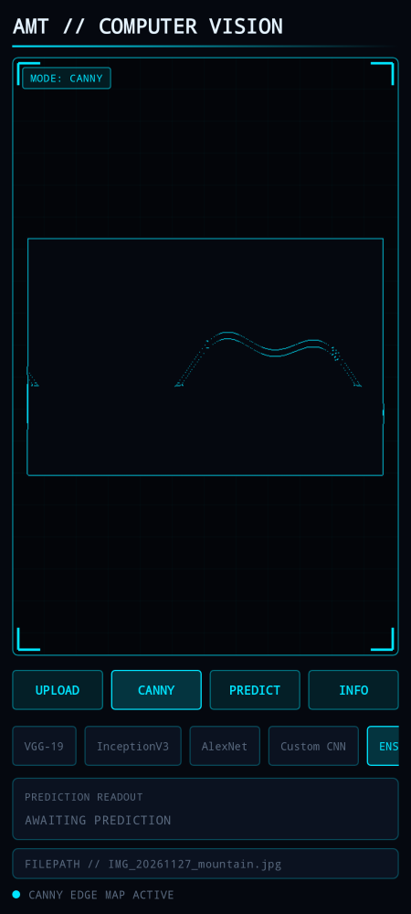
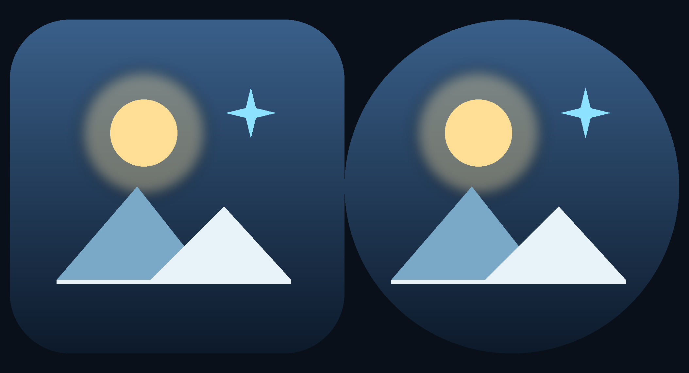

# MOAZ Computer Vision (Android)

Native Android version of the AMT computer-vision course task: an image
classifier with a gaming HUD interface, written in **Kotlin + Jetpack Compose**.





## Features

- **Upload Image**: pick an image from the gallery; shown in the HUD viewport
  with shape, dimensions and file path.
- **Canny**: toggles a real Canny edge map (implemented in pure Kotlin:
  gaussian blur, Sobel, non-max suppression, double threshold + hysteresis),
  rendered as neon edges.
- **Predict**: runs a TensorFlow Lite model and shows the predicted class,
  confidence bar and top-3 guesses.
- **Model selector**: MobileNetV2, InceptionV3, ResNet50, EfficientNet-Lite0 and
  EfficientNet-Lite2, each with its own input size and preprocessing from
  `models_config.json`.
- **Ensemble (advanced challenge)**: averages the probabilities of every
  available model and reports which models were used/skipped.
- **Unified neon theme**: one cyan accent on deep-space dark, HUD grid,
  targeting brackets, mode readout (STANDBY / RGB / CANNY).
- **About screen**: the "i" button in the top bar opens a full guide - what the
  app does, how to use it, the bundled models, ensemble mode, privacy and
  credits.
- **Custom launcher icon**: original generated artwork (calm landscape photo
  glyph + AI sparkle), no external assets, free to use. Regenerate with
  `python3 tools/make_icon.py`.



## Build & run

It works out of the box: five pretrained ImageNet models are already in
`app/src/main/assets/models/`, so there is nothing to download, train or convert.

1. Clone the repo and open it in **Android Studio** (Hedgehog or newer, JDK 17).
2. Let Gradle sync, then run on a device or emulator (minSdk 24).
   Or from a terminal: `./gradlew assembleDebug` and install
   `app/build/outputs/apk/debug/app-debug.apk`.
3. Tap **UPLOAD**, pick any photo, tap **PREDICT**.

Everything runs on the phone, offline. No server, no account, no cost.

## The bundled models

Pretrained on ImageNet (1000 everyday classes: animals, vehicles, food, objects,
places, people's clothing), so any ordinary photo gets a sensible answer, not only
nature scenes. `classes.txt` holds the 1000 names.

| model in the selector | size | source |
|---|---|---|
| MobileNetV2 | 7 MB | Keras ImageNet weights, converted to float16 TFLite |
| InceptionV3 | 48 MB | same |
| ResNet50 | 51 MB | same |
| EfficientNet-Lite0 | 19 MB | Google MediaPipe model storage, used as published |
| EfficientNet-Lite2 | 24 MB | same |
| **ENSEMBLE (ALL MODELS)** | | averages the probabilities of the five models above |

`python tools/make_pretrained_models.py` rebuilds all of them (needs
`pip install tensorflow-cpu pillow`).

Check the numbers without a phone:

```
python tools/predict_demo.py photo1.jpg photo2.jpg
```

It resizes and normalises each photo exactly the way the app does and prints the
top-3 per model plus the ensemble.

## Using your own trained models (optional)

Only if you want the app to run weights you trained yourself, for example the Intel
scenes classifier from the course. Remove or keep the bundled files, then three steps
from the repo root. Note that `models_config.json` and `classes.txt` in the assets
folder describe the bundled ImageNet models; the converter rewrites them for yours.

### 1. Train, or bring your own `.h5`

```
python training/train_models.py --data-dir /path/to/seg_train --epochs 10
```

This writes `models/*.h5` plus `models_config.json` and `classes.txt` at the
repo root. Both are gitignored: they describe your weights, not the app.

- `--models custom_cnn vgg19` trains a subset.
- `--output logits` trains without a final softmax (see "logits vs softmax").
- The dataset folder needs one subfolder per class, the layout of
  [Intel Image Classification](https://www.kaggle.com/datasets/puneet6060/intel-image-classification).
- Class names are written in the generator's label order, which is the order
  the app uses to name predictions.

Already have `.h5` files from another script? Skip to step 2 and point
`--weights-dir` at them; the converter reads the preprocessing and output mode
off the model itself.

### 2. Convert

```
python tools/convert_to_tflite.py
```

Reads `models_config.json` (falling back to the app's own
`app/src/main/assets/models_config.json` when there is no root manifest),
converts every `.h5` it finds in `models/` into
`app/src/main/assets/models/`, then rewrites the app's config and class list.
Weights that are missing are skipped, not an error.

Explicit paths, when your files live elsewhere:

```
python tools/convert_to_tflite.py \
    --config my_models.json --labels my_classes.txt --weights-dir /path/to/h5
```

Other flags: `--model "Custom CNN"` (one model), `--set-preprocess caffe`,
`--set-output logits` (override what the converter detects),
`--check-only` (verify an existing setup without converting).

Each conversion is checked as it runs: the same input tensor goes through Keras
and through the new `.tflite`, and you should see a line like

```
        parity: keras=sea (0.9933)  tflite=sea (0.9933)  max|diff|=3.17e-08  [softmax]
```

A mismatch stops that model instead of shipping a wrong one. With more than one
model each is converted in its own process, so a heavy VGG-19 conversion cannot
run the machine out of memory halfway through the others.

### 3. Rebuild

Predict now runs your models. If a file name, input size or preprocessing
differs from the defaults, edit `app/src/main/assets/models_config.json` by
hand (or re-run the converter with the right flags).

## Preprocessing: the part that must match

A model only recognises what it was trained on. Feed it a differently scaled
image and it still returns confident-looking numbers, just wrong ones. There
are five modes and both sides use the same five:

| mode      | what it does                                   | value range |
|-----------|------------------------------------------------|-------------|
| `raw`     | RGB unchanged (the graph normalises itself)    | 0..255      |
| `rescale` | RGB / 255                                      | 0..1        |
| `tf`      | RGB / 127.5 - 1                                | -1..1       |
| `caffe`   | RGB -> BGR, minus `[103.939, 116.779, 123.68]` | about -124..131 |
| `effnet`  | (RGB - 127) / 128 (EfficientNet-Lite)          | about -1..1 |

`raw` exists for one reason: some `.h5` files normalise their own input. A model
whose graph starts with `Rescaling(1/255)` must be fed 0..255, not 0..1,
or the division happens twice and the image collapses to near zero. The
converter spots that layer and writes `preprocess: "raw"` for you.

Each entry in `models_config.json`:

| field        | meaning                                                    |
|--------------|------------------------------------------------------------|
| `name`       | label in the model selector                                |
| `file`       | `.tflite` in `app/src/main/assets/models/`                 |
| `input_size` | `[width, height]` the bitmap is resized to                 |
| `preprocess` | one of the five modes above                                |
| `output`     | `softmax` (probabilities) or `logits` (raw scores)         |

### logits vs softmax

`output: "softmax"` means the last layer already produces probabilities summing
to 1, so the app uses them as they are. `output: "logits"` means raw scores, and
the app applies softmax. Applying softmax twice is not harmless: the ranking
survives but every score is pushed toward `1 / number_of_classes`, so a model
that was sure of itself displays as barely guessing.

The converter reads this off the model's last layer, so both stay honest even
if you edit the config by hand.

The two implementations are `common/preprocess.py` (used by training and by the
conversion/verification scripts) and `Preprocessing.kt` (used by the app).
`PreprocessingTest` holds the reference numbers for all five modes; if it fails,
the phone and the trainer have drifted apart.

## Checking a model end to end

```
python tools/verify_parity.py --image /path/to/photo.jpg
python tools/verify_parity.py --image photo.jpg --model alexnet --top-k 3
```

Prints the top classes and scores from the `.h5` and from the `.tflite`, plus
the largest difference between them, and exits non-zero if the top class or the
score disagrees. `--tflite-only` skips the Keras side when you only have the
converted file. `--dump-tensor FILE` writes the exact input tensor it fed both.

The app's side of the same check is a plain unit test: open the project in
Android Studio and run `PreprocessingTest`
(`app/src/test/java/com/amt/vision/ml/PreprocessingTest.kt`).

## Troubleshooting

| symptom | cause |
|---|---|
| `MISSING WEIGHTS` on Predict | no `.tflite` in `app/src/main/assets/models/` with the name in `models_config.json` |
| `INFERENCE ERROR: ... outputs 6 values but classes.txt has 3 classes` | class list and model disagree; convert again with the right `--labels` |
| every prediction looks nearly identical, confidence around `1/N` | softmax applied to a softmax: set `output: "softmax"` if the model ends in one |
| confident but wrong predictions on every image | preprocessing mismatch: check the mode against how the model was trained |
| converter says `no models/<name>.h5 in models` | weights are missing or named differently; use `--weights-dir` |

## Project layout

```
app/src/main/java/com/amt/vision/
    ui/          Compose screens and theme
    ml/          Canny, model registry, preprocessing
    vm/          state (ViewModel)
app/src/test/    Paparazzi screenshot tests (the images above) + PreprocessingTest
app/src/main/assets/
    models/            the bundled .tflite files
    models_config.json model list: name, file, input size, preprocess, output
    classes.txt        class names, one per line
common/preprocess.py     the five modes, shared by every script
training/train_models.py trains your own models (Intel dataset), optional
tools/convert_to_tflite.py  .h5 -> .tflite, with a parity check per model
tools/verify_parity.py      Keras vs TFLite on a real image
tools/make_pretrained_models.py  builds the bundled ImageNet models
tools/predict_demo.py       prints what every bundled model says about your photos
```
