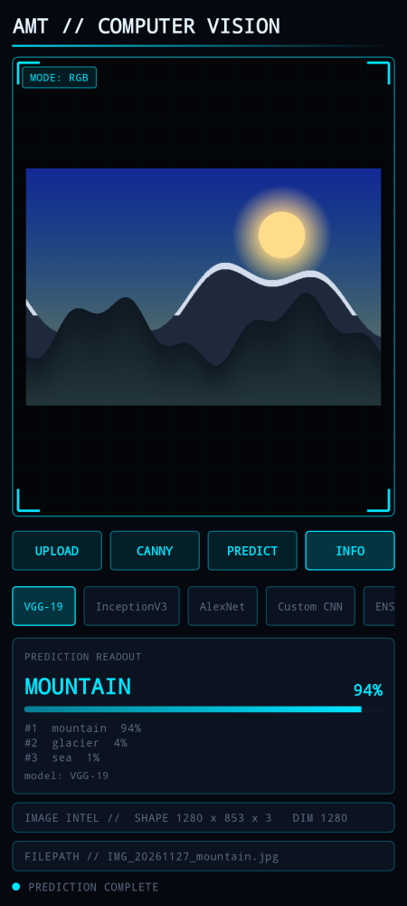

# AMT // Computer Vision (Android)

Native Android version of the AMT computer-vision course task: an image
classifier with a gaming HUD interface, written in **Kotlin + Jetpack Compose**.





## Features

- **Upload Image**: pick an image from the gallery; shown in the HUD viewport
  with shape, dimensions and file path.
- **Canny**: toggles a real Canny edge map (implemented in pure Kotlin:
  gaussian blur, Sobel, non-max suppression, double threshold + hysteresis),
  rendered as neon edges.
- **Predict**: runs a TensorFlow Lite model and shows the predicted class,
  confidence bar and top-3 guesses.
- **Model selector**: VGG-19, InceptionV3, AlexNet and Custom CNN, each with
  its own input size and preprocessing from `models_config.json`.
- **Ensemble (advanced challenge)**: averages the probabilities of every
  available model and reports which models were used/skipped.
- **Unified neon theme**: one cyan accent on deep-space dark, HUD grid,
  targeting brackets, mode readout (STANDBY / RGB / CANNY).

## Build & run

1. Open the repo in **Android Studio** (Hedgehog or newer).
2. Let Gradle sync, then run on a device or emulator (minSdk 24).

## Adding the trained models

The `.tflite` weight files are not in the repo (too large). The app runs
without them and reports "missing weights" on Predict until you add them.

1. Put your trained `.h5` files in `models/` (same names as
   `models_config.json`: `vgg19.h5`, `inceptionv3.h5`, `alexnet.h5`,
   `custom_cnn.h5`). Train them with `training/train_models.py` if needed.
2. Convert them to TensorFlow Lite:
   ```
   python tools/convert_to_tflite.py
   ```
   This writes the `.tflite` files into `app/src/main/assets/models/` and
   updates `app/src/main/assets/models_config.json` and `classes.txt`.
3. Rebuild. If your file names, input sizes or preprocessing differ, edit
   `app/src/main/assets/models_config.json` by hand.

Preprocess modes supported: `caffe` (BGR, VGG mean), `tf` (-1..1),
`rescale` (0..1). Class labels live in `app/src/main/assets/classes.txt`.

## Project layout

- `app/src/main/java/com/amt/vision/ui` - Compose screens and theme
- `app/src/main/java/com/amt/vision/ml` - Canny + TFLite model registry
- `app/src/main/java/com/amt/vision/vm` - state (ViewModel)
- `app/src/test` - Paparazzi screenshot tests (the images above)
- `tools/convert_to_tflite.py` - .h5 -> .tflite conversion
- `training/train_models.py` - trains the 4 default models (Intel dataset)
